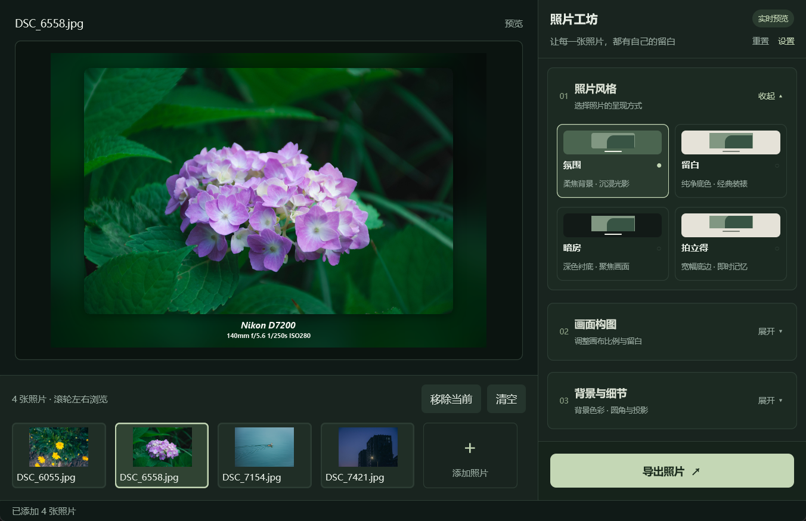
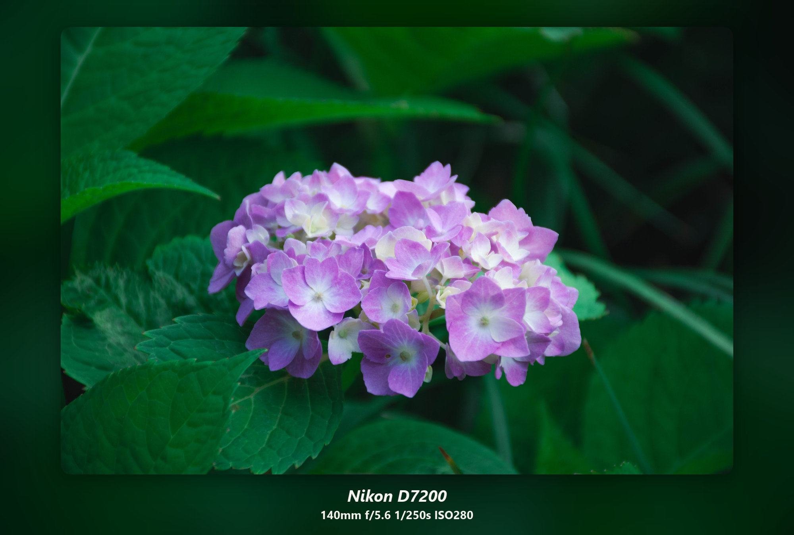
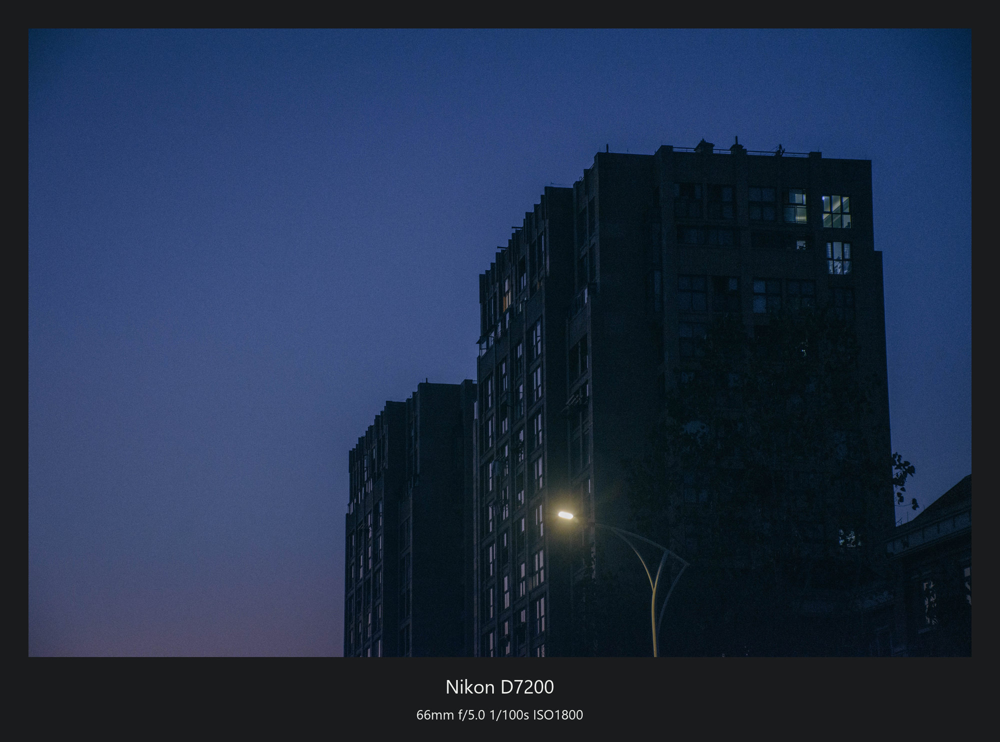
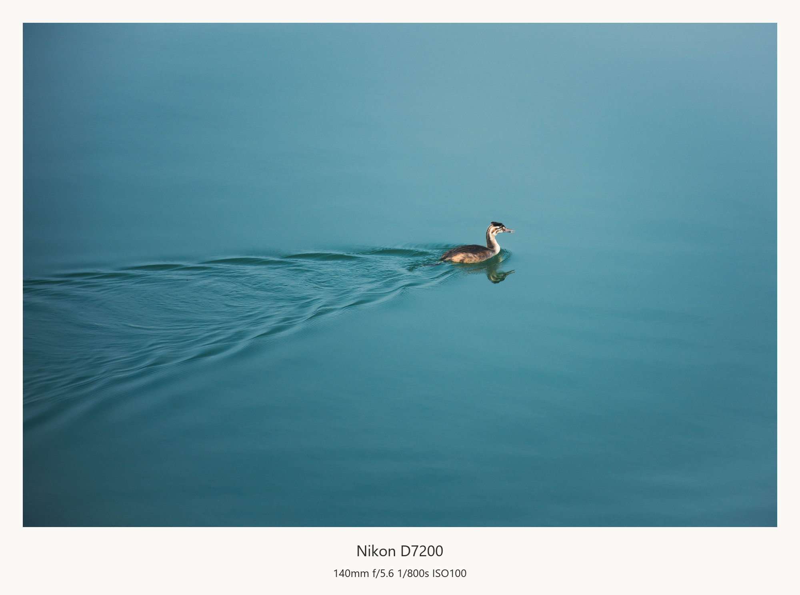
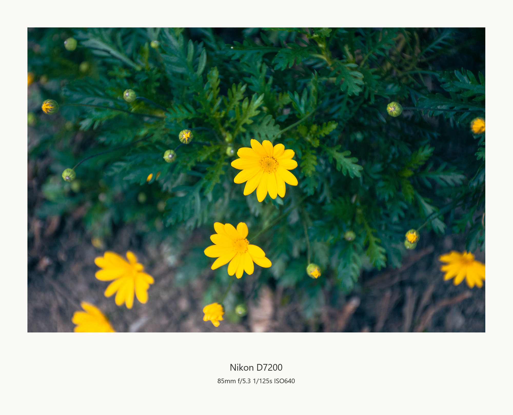

# 印框 · PhotoFrame

使用 Rust + GPUI 构建的本地照片装裱工具，为照片添加留白、柔焦背景和拍摄信息。



## 功能

- 氛围、留白、暗房、拍立得四种预设，各自记忆调整，支持确认后恢复默认。
- 自定义画布比例、留白、背景、圆角和投影，实时预览效果。
- 读取 EXIF 拍摄信息，支持自定义字体、文字及模板。
- 单张或批量导出 JPEG、PNG、WebP，同名文件自动编号，保留原图。
- 英文与简体中文界面，默认跟随系统语言。

## 效果示例

| 氛围 | 暗房 |
| --- | --- |
|  |  |
| 将照片色彩延展为柔焦背景，配合圆角与轻投影，让画面自然融入相框。适合花卉、人像等色彩丰富的照片。 | 以深色边框衬托画面，搭配浅色拍摄信息，突出光影层次。适合夜景、城市和暗调作品。 |

| 留白 | 拍立得 |
| --- | --- |
|  |  |
| 用简洁的浅色留白分隔照片与周围环境，让构图和主体更清楚。底部保留拍摄信息，适合风景与日常记录。 | 加宽底部留白，呈现拍立得相纸般的比例。可以写下拍摄信息或一句短文，记录照片之外的故事。 |

## 构建与运行

目前经过桌面运行验证的平台为 **Windows x64**。Windows 构建需要 Rust stable（支持 edition 2024）、Visual Studio C++ 桌面工具链及 Windows SDK。

```powershell
cargo build --release --locked
.\target\release\photo-frame.exe
```

GPUI 需要 Windows SDK 中的 `fxc.exe`。若无法自动找到，请将其完整路径设置为环境变量 `GPUI_FXC_PATH`。

Linux x64 编译由 GitHub Actions 的 **Build and draft release** 工作流中的 `linux` 任务检查，使用 Ubuntu 24.04 构建 Release，成功后可从 Artifacts 下载包含程序与许可证的 `photo-frame-linux-x64` 压缩包。该构建不包含桌面运行测试，也不代表兼容所有 Linux 发行版。

macOS Apple Silicon（arm64）使用 `macos-15` runner 执行检查、测试与 Release 构建，并检查 GPUI 所需的 Xcode SDK 和 Metal 工具链。产物 `photo-frame-macos-arm64` 包含可执行程序及许可证，解压后在终端执行 `./photo-frame`；当前不包含 `.app` 打包，桌面运行兼容性尚待实机验证。

界面使用 GPUI 默认字体及系统字体回退，不附带字体文件。Linux 中文环境建议安装 `fonts-noto-cjk`；文字导出的自定义字体仍由应用内设置控制。

启动后拖入照片，选择风格、调整文字，再点击“导出照片”。支持导入 JPEG、PNG、WebP、TIFF 和 BMP；暂不支持 RAW／HEIC。

预览区支持滚轮围绕鼠标位置缩放（相对适应窗口的 1×～4×），放大后按住左键拖动；右上角滑杆可直接调节缩放倍数，点击“适应窗口”恢复。切换照片时，旧图保持当前缩放和位置淡出，新图以 1× 淡入。缩放仅影响预览显示，放大后的清晰度受预览分辨率限制。

## 开发

```sh
cargo fmt --check
cargo test --locked
cargo clippy --all-targets --locked -- -D warnings
```

## 发布

推送与 Cargo 版本一致的标签（当前为 `v1.1.0`），或在 GitHub Actions 中手动运行 **Build and draft release**。普通 push 和 pull request 不触发构建。Windows、Linux 和 macOS 构建并行运行，分别打包为 Windows ZIP、Linux TAR.GZ 和 macOS arm64 TAR.GZ；各平台产物上传至 Artifacts，全部成功后一起上传到草稿 Release，确认后可手动发布。

## 许可

© Marisa9961 · [MIT License](LICENSE) · [第三方许可与署名](THIRD_PARTY_NOTICES.md)
